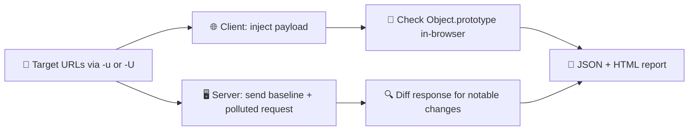

<div align="center">

# 🧩 ppfinder

**Hunt prototype pollution on both sides of the wire, from one CLI.**
A client-side (browser) and server-side (black-box) scanner for bug bounty hunters and pentesters.


<br>

<!-- Replace with a screenshot or terminal recording of a scan -->


[How it works](#-how-it-works) · [Features](#-features) · [Usage](#-usage) · [CLI flags](#-cli-flags) · [Customize](#-customize) · [Responsible use](#%EF%B8%8F-responsible-use)

</div>

---

## 💡 What is it?

Proving prototype pollution usually means hand-crafting the same bracket, dot-notation and encoded payload variants over and over, for every injection point, on both the browser and the server. **ppfinder** automates that.

Point it at a target with `client`, `server`, or `both`, and it runs a battery of pollution payloads, checks whether `Object.prototype` actually got polluted (client-side) or whether the response shape changed in a telltale way (server-side, black-box), and writes a report.

It's a scanner, not an exploit framework: it confirms pollution and flags likely gadgets, it doesn't chain them into an exploit for you.

## ⚙️ How it works



## ✨ Features

| | |
|---|---|
| 🧩 **Dual-mode scanning** | Test client-side (real browser) and server-side (black-box HTTP) pollution from the same command. |
| 🧪 **Many bypass variants** | Plain, bracket, dot-notation, URL-encoded, double-encoded, mixed-case and nested-depth payloads, not just `__proto__`. |
| 🪝 **Four client-side injection points** | Query string, URL hash, `postMessage`, and `localStorage`. |
| 🧬 **Gadget fingerprinting** | Detects known-vulnerable libraries (jQuery, AngularJS, Lodash, Vue) and attempts a heuristic DOM-reflection PoC. |
| 🧾 **Diff-based server detection** | Compares baseline vs. polluted responses (status code, headers, body) using non-destructive gadgets like Express's `json spaces`. |
| 🛡️ **Safe mode by default** | Risky/destructive payloads stay off unless you pass `--aggressive`. |
| 🚦 **Shared rate limiting** | One token bucket is shared across every thread, so `--threads` can't silently outrun `--rate-limit`. |
| 📊 **JSON + HTML reports** | One `-o` flag writes both a machine-readable JSON file and a readable HTML report. |
| 🧭 **Burp-friendly** | Route every request through `--proxy` to inspect and replay manually. |

---

## 🚀 Usage

**Option 1: automated install**

```bash
unzip ppfinder.zip && cd ppfinder
./install.sh
```

`install.sh` checks Python and pip, installs `requests` and `playwright`, downloads Playwright's Chromium binary, and links a `ppfinder` command onto your `PATH`.

**Option 2: manual install**

```bash
pip install --break-system-packages -r requirements.txt
python3 -m playwright install chromium
```

Then run it with `python3 cli.py ...` instead of `ppfinder ...`.

**Then:**

```bash
ppfinder client -u https://test.com --inject-points query,hash -v

ppfinder server -u https://api.test.com/update-profile --method POST \
  --content-types json,urlencoded --body-template body.json --rate-limit 5 -o report.json

ppfinder both -U targets.txt --threads 10 --rate-limit 20 -o results/
```

> 💡 `-u`/`--url` accepts a single URL, a comma-separated list, or the flag repeated. Combine it with `-U`/`--url-file` (one URL per line) and ppfinder de-duplicates targets automatically.

> 💡 For server-side scans, `--body-template` must point to a sample **valid** request body for that endpoint — ppfinder is black-box, so it doesn't know the target's schema on its own.

---

## 🧩 CLI flags

### Shared

| Flag | Description |
|---|---|
| `-u, --url` | Target URL(s): single, comma-separated, or the flag repeated |
| `-U, --url-file` | File of target URLs, one per line |
| `-o, --output` | Output path (without extension); writes `.json` and `.html` |
| `--threads` | Parallel workers across targets (default `5`) |
| `--rate-limit` | Max requests/page-loads per second, shared across all threads (default `5`) |
| `--timeout` | Timeout per request/page load, in seconds (default `10`) |
| `--proxy` | Proxy URL, e.g. `http://127.0.0.1:8080`, to route through Burp |
| `--headers` | Extra headers as a JSON string, or a path to a JSON file |
| `--payloads` | Path to a custom payload file to extend/override the defaults |
| `-v, --verbose` | Print per-attempt output |
| `--safe-mode` | Disable risky payloads (default) |
| `--aggressive` | Enable risky/destructive payloads |

### Client-side

| Flag | Description |
|---|---|
| `--headless` / `--no-headless` | Run the browser headless (default) or visibly |
| `--inject-points` | Comma-separated: `query,hash,postmessage,localstorage` |
| `--gadget-scan` | Attempt gadget/impact detection after pollution is confirmed |
| `--wait-for` | Milliseconds to wait after page load before checking `Object.prototype` (default `500`) |
| `--browser` | Browser engine: `chromium`, `firefox`, or `webkit` |

### Server-side

| Flag | Description |
|---|---|
| `--content-types` | Comma-separated: `json,urlencoded,query` |
| `--method` | HTTP method for server-side requests (default `POST`) |
| `--body-template` | Path to a JSON file with a sample valid request body to merge payloads into |
| `--diff-baseline` | Number of baseline requests sent before comparing (default `2`) |

---

## 🛠️ Customize

- **Add a client-side bypass:** add a variant to `client_side/payloads.py`
- **Add a server-side gadget check:** add an entry to `server_side/payloads.py` (`build_safe_payloads` or `build_aggressive_payloads`)
- **Override defaults at runtime:** point `--payloads` at your own payload file instead of editing the source
- **Change report styling:** edit the HTML template in `report/html_report.py`

---

## ⚖️ Responsible use

This tool is for authorized security research and bug bounty work. Only test targets that are **in scope** for a program you're participating in, or that you have explicit permission to test.

- `--safe-mode` is on by default; only pass `--aggressive` when you understand and accept the risk of destabilizing the target
- Server-side pollution can affect process-wide state — a notable diff on one request can persist and affect requests after it, even unrelated ones, until the process restarts
- Report findings to the target owner through the proper channel and follow the program's disclosure rules

<div align="center">
<sub>Built for hunters who check Object.prototype before they check the box. 🧩</sub>
</div>
